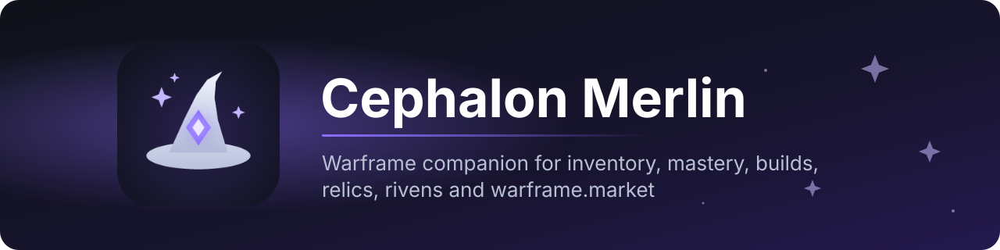

  

  
  
  

  <a href="https://github.com/TvMerlinTv/Cephalon-Merlin/releases/latest/download/Cephalon.Merlin.exe"><b>⬇&nbsp; Download Cephalon Merlin</b></a>
  &nbsp;·&nbsp;
  <a href="https://github.com/TvMerlinTv/Cephalon-Merlin/releases">All versions</a>

---

**Cephalon Merlin** is a free companion app for [Warframe](https://www.warframe.com) on PC.
One click reads your inventory from the running game – then you see what you still need to master,
which builds the community plays, which relics are worth opening, what your items sell for on
warframe.market and when the next cycle changes. While you play, an overlay shows the rewards after
fissure missions together with their platinum and ducat value.

## ✨ Features

| | Section | What it does |
|:-:|---|---|
|  | **Foundry** | All frames, weapons and companions with their components – what you have and what's missing. |
|  | **Mastery Helper** | What you still need to master, with a to-do list and the relics that drop the missing parts. |
|  | **Inventory** | Your tradeable items with their platinum and ducat value. |
|  | **Relic Planner** | Which of your relics are worth opening. |
|  | **Builds** | Popular builds from overframe.gg with mods and guide. |
|  | **Rivens** | Your rivens with stats, disposition and market prices. |
|  | **Warframe Market** | Current prices and offers from warframe.market. |
|  | **Trading** | What to sell for platinum and what to trade to Baro for ducats. |
|  | **Statistics** | History of your account values and a log of your fissure rewards. |
|  | **Timers** | World cycles, void fissures and Baro Ki'Teer – live, with optional notifications. |
|  | **In-game overlay** | Shows fissure rewards and their value right inside the game. |

The app is available in **English** and **German**.

## 🚀 Getting started

1. **[Download Cephalon Merlin.exe](https://github.com/TvMerlinTv/Cephalon-Merlin/releases/latest/download/Cephalon.Merlin.exe)** and put it anywhere, e.g. on your desktop – no installation needed.
2. Start Warframe and log in.
3. In Cephalon Merlin, click **“Sync with game”** in the top left.
4. For the overlay, set Warframe to **“Borderless Fullscreen”** (Options → Display).

> [!NOTE]
> The .exe is not code-signed, so Windows SmartScreen may warn you on first launch:
> click **“More info” → “Run anyway”**.

## ❓ FAQ

<b>Syncing with the game doesn't work</b>

Warframe has to be running and you have to be logged in. If it still fails, enter a loading screen
once (e.g. start a mission or go to the dojo) and sync again. If Warframe runs as administrator,
Cephalon Merlin has to as well.

<b>The overlay doesn't show up in the game</b>

Set Warframe to “Borderless Fullscreen”. Windows can't draw windows on top of exclusive fullscreen.
Also check Settings → Overlays to make sure the overlay is turned on.

<b>How do I get updates?</b>

Automatically: Cephalon Merlin checks for a new version on start and every few hours – or right
away via Help / Info → “Check for updates”. When one is available, “Update x.y.z” appears in the
title bar; one click on “Update now” downloads it and restarts the app. Your settings and data stay
as they are.

<b>What does Cephalon Merlin read from the game?</b>

Cephalon Merlin only reads and never changes anything in the game. To get your inventory it reads
the session token from the running game and uses it to load your inventory from Digital Extremes
once – the same request the game makes itself. The token is never saved, shown or shared. The
overlay reads the screen with text recognition and never clicks anything in the game.

Reading game data is not officially approved by Digital Extremes, and no third-party tool is
guaranteed to be ban-safe. If in doubt, check DE's terms of service.

<b>Where is my data stored?</b>

Everything stays on your PC in `%APPDATA%\Cephalon Merlin` (button “Open data folder” under
Help / Info). Deleting that folder resets Cephalon Merlin.

## 🙏 Data sources

[warframe.market](https://warframe.market) (prices, riven auctions) ·
[overframe.gg](https://overframe.gg) (builds) ·
[warframestat.us](https://hub.warframestat.us) (world state, set prices) ·
[WFCD/warframe-items](https://github.com/WFCD/warframe-items) (item database, drops) ·
[WFCD/warframe-worldstate-data](https://github.com/WFCD/warframe-worldstate-data) ·
[warframe-public-export-plus](https://github.com/calamity-inc/warframe-public-export-plus) (riven data) ·
[Warframe Wiki](https://wiki.warframe.com)

---

Cephalon Merlin is a fan project and is not affiliated with Digital Extremes. Warframe and all
related names and images are property of Digital Extremes Ltd.
